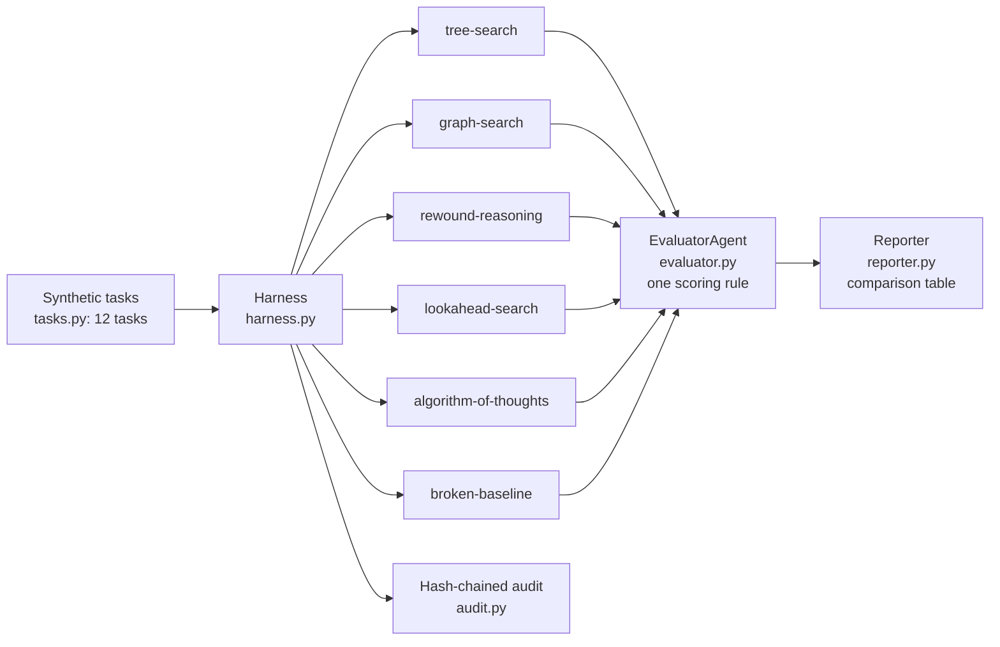
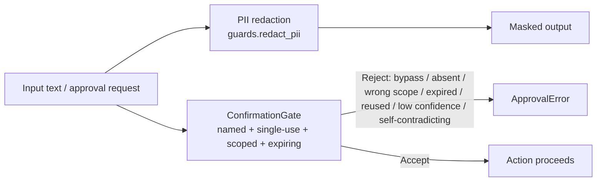

# Architecture

## Harness flow

Every method receives the same `Task` objects and the same budget. Runs are
independent: no method's output feeds another's input, and run order
cannot change scores (tested).

## Per-method strategies

```mermaid
flowchart TD
    subgraph Tree["tree-search: depth-first"]
        A1[Visit node] --> A2{Goal?}
        A2 -->|Yes| A3[Solved]
        A2 -->|No| A4[First untried branch, recurse]
        A4 --> A1
    end
    subgraph Graph["graph-search: breadth-first + visited"]
        B1[Dequeue node] --> B2{Goal?}
        B2 -->|Yes| B3[Solved]
        B2 -->|No| B4[Enqueue unvisited children]
        B4 --> B1
    end
    subgraph Rewound["rewound-reasoning: DFS + trap prune"]
        C1[Visit node] --> C2{Trap marker?}
        C2 -->|Yes| C3[Record retry, prune subtree]
        C2 -->|No| C4[DFS as tree-search]
    end
    subgraph Lookahead["lookahead-search: signal-ordered DFS"]
        D1[Score children by 2-step signal lookahead] --> D2[DFS in score order]
    end
    subgraph AoT["algorithm-of-thoughts: plan-then-solve"]
        E1[Enumerate mid-depth checkpoints in signal order] --> E2[Bounded DFS from each checkpoint]
        E2 --> E3{Goal reached?}
        E3 -->|No| E2
    end
```

## Guardrails

See also: [`methodology-and-limits.md`](methodology-and-limits.md),
[`../docs/implementation-guide.md`](../docs/implementation-guide.md),
[`../docs/threat-model.md`](../docs/threat-model.md).
